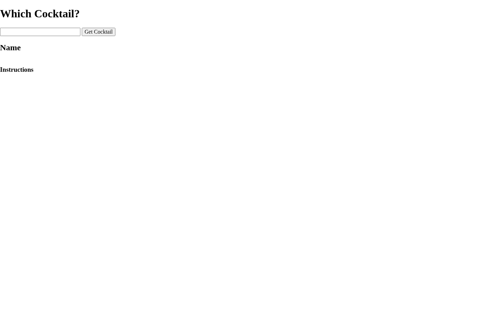
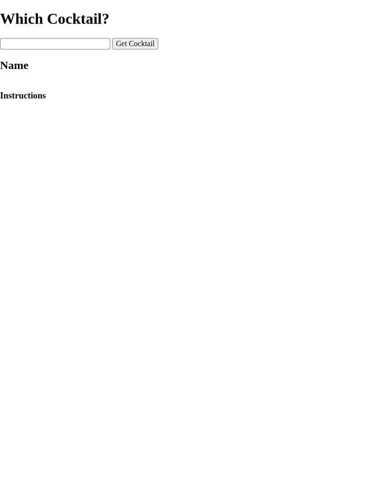
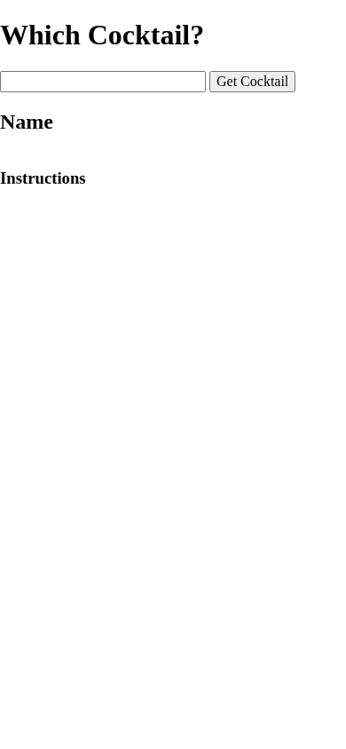

# Please Give Me a Drink... Recipe

Search TheCocktailDB for a cocktail and view its image and preparation instructions.

## Overview

Please Give Me a Drink... Recipe lets a user search for a cocktail by name.

The application sends the search term to TheCocktailDB, selects the first matching drink returned by the API, and displays the drink name, image, and preparation instructions in the browser.

## Features

- Search for a cocktail by name
- Retrieve cocktail data from TheCocktailDB
- Display the returned drink name
- Display the cocktail image
- Display preparation instructions
- Update the page dynamically with the returned result

## Technologies

<p>
  <a href="https://developer.mozilla.org/en-US/docs/Web/HTML" title="HTML">
    
  </a>
  &nbsp;
  <a href="https://developer.mozilla.org/en-US/docs/Web/CSS" title="CSS">
    
  </a>
  &nbsp;
  <a href="https://developer.mozilla.org/en-US/docs/Web/JavaScript" title="JavaScript">
    
  </a>
</p>

- [TheCocktailDB API](https://www.thecocktaildb.com/api.php)

## How to Run

1. Clone the repository:

```bash
git clone https://github.com/nilesleesmith/please-give-me-a-drink...recipe.git
```

2. Open the project folder.

3. Open `index.html` in a web browser.

An internet connection is required to retrieve cocktail data from TheCocktailDB. No additional packages or build steps are required.

## Live Site

Coming soon.

## Screenshots

### Desktop



### Tablet



### Mobile



## Alcohol Disclaimer

This project is a programming exercise created for educational purposes.

It retrieves cocktail information and drink recipes from a public API. The presence of alcoholic drink information in this application is not intended to encourage alcohol consumption.

Please follow the laws and legal drinking-age requirements where you live.

If you choose to drink alcohol:

- Drink responsibly.
- Do not drink and drive.
- Do not operate machinery while impaired.
- Avoid mixing alcohol with medications unless a qualified medical professional has confirmed it is safe.
- Do not provide alcohol to anyone who is under the legal drinking age.
- Consider choosing a non-alcoholic alternative if drinking could put your health or safety at risk.

## Alcohol Help

Alcohol use can become harmful when it begins affecting your health, relationships, finances, work, school, or ability to control how much you drink.

If you are concerned about your drinking or someone else's drinking, support is available.

### United States

**SAMHSA National Helpline**

**Phone:** 1-800-662-HELP (4357)

**TTY:** 1-800-487-4889

### Alcoholics Anonymous

Alcoholics Anonymous provides peer-support meetings for people who want help with alcohol use.

Meetings are available in many areas and may be offered in person or online.

### Practical Safety Steps

- Avoid situations where you are likely to drink.
- Remove alcohol from your immediate environment.
- Ask a trusted person for support.
- Speak with a healthcare professional or counselor.
- Look for local treatment or recovery-support programs.
- Avoid driving or other dangerous activities after drinking.

Stopping heavy or long-term alcohol use suddenly can sometimes cause serious withdrawal symptoms. If you regularly drink large amounts of alcohol or have experienced withdrawal before, consider getting medical guidance before stopping abruptly.

### Emergency Situations

Alcohol poisoning can be life-threatening.

Seek emergency medical help if someone who has been drinking has symptoms such as:

- Difficulty waking up
- Confusion or unconsciousness
- Vomiting repeatedly
- Seizures
- Slow or irregular breathing
- Pale, bluish, or clammy skin

Do not assume someone can simply "sleep it off."

If there is an immediate medical emergency, contact your local emergency service.
